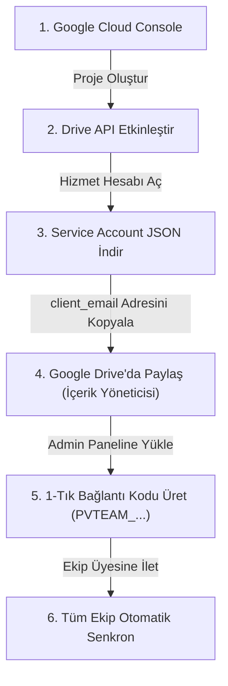

# PromptVault Team Edition 👥

> **Kurumsal AI Prompt & Sistem Varlığı Kasası**  
> ChatGPT, Google Gemini, Claude, ComfyUI ve Stable Diffusion için ortak ekip kütüphanesi; **Gemini Gems**, **Custom GPTs**, **Claude Skills** yönetim merkezi ve **Google Workspace Ortak Drive (Shared Drive)** ile anında çift yönlü senkronizasyon motoru.

[](https://python.org)
[](https://fastapi.tiangolo.com)
[](https://developers.google.com/drive)
[](LICENSE)
[]()

---

## 📌 İçindekiler

- [PromptVault Bireysel ve Team Karşılaştırması](#-promptvault-bireysel-ve-team-karşılaştırması)
- [Hızlı Başlangıç (Quick Start)](#-hızlı-başlangıç-quick-start)
- [🔑 Google Cloud Service Account Kurulumu (%100 Ücretsiz)](#-google-cloud-service-account-kurulumu-100-ücretsiz)
- [🔗 1-Tık Ekip Bağlantı Kodu (`PVTEAM_...`)](#-1-tık-ekip-bağlantı-kodu-pvteam_)
- [🛡️ Google SSO, Kurumsal Alan Adı & Rol Yönetimi (RBAC)](#-google-sso-kurumsal-alan-adı--rol-yönetimi-rbac)
- [🌟 Temel Yetenekler & Özellikler](#-temel-yetenekler--özellikler)
  - [1. LLM Sistem Varlıkları (Gems, Custom GPTs, Claude Skills)](#1-llm-sistem-varlıkları-gems-custom-gpts-claude-skills)
  - [2. Visual Vault & PNG Meta Ayrıştırıcı](#2-visual-vault--png-meta-ayrıştırıcı)
  - [3. Gerçek Zamanlı Drive Senkronizasyonu (Real-Time Sync)](#3-gerçek-zamanlı-drive-senkronizasyonu-real-time-sync)
  - [4. Akıllı Otomatik Terminal Kapatma (Auto-Shutdown Heartbeat)](#4-akıllı-otomatik-terminal-kapatma-auto-shutdown-heartbeat)
- [📂 Proje Dizin Yapısı](#-proje-dizin-yapısı)
- [❓ Sıkça Sorulan Sorular ve Sorun Giderme](#-sıkça-sorulan-sorular-ve-sorun-giderme)

---

## ⚖️ PromptVault Bireysel ve Team Karşılaştırması

| Özellik | Bireysel Sürüm (`promptvault`) | Ekip Sürümü (`promptvault-team`) |
| :--- | :---: | :---: |
| **Kullanım Amacı** | Kişisel lokal prompt arşivi | Ajanslar, şirketler ve ortak çalışan AI ekipleri |
| **Veri Depolama** | Yerel SQLite veritabanı | Yerel ACID Önbellek + **Google Workspace Shared Drive** |
| **Kimlik Doğrulama** | Yok (Tek kullanıcılı masaüstü) | **Google SSO / OAuth**, Kurumsal Domain & E-posta Whitelist |
| **Rol Yetkilendirme** | Yok | **Admin**, **Editor**, **Viewer** (RBAC) |
| **Ekip Dağıtımı** | Gerekmez | **1-Tık Ekip Kodu (`PVTEAM_...`)** ile anında kurulum |
| **Çalışma Portları** | Port `7860` | Admin: Port `7861` / Çalışan: Port `7862` |
| **Terminal Kapatma** | Tarayıcı kapanınca otomatik kapanır | Tarayıcı kapanınca otomatik kapanır |

---

## 🚀 Hızlı Başlangıç (Quick Start)

### 1. Gereksinimler
- **Python 3.10** veya daha yeni bir sürüm ([python.org](https://www.python.org/downloads/))
- Modern bir web tarayıcısı (Chrome, Edge, Firefox, Brave)
- *(İsteğe Bağlı)* Şirket Google Workspace veya Gmail hesabı

### 2. İndirme ve Kurulum
```bash
git clone https://github.com/yogruce/promptvault-team.git
cd promptvault-team
```

### 3. Windows'ta 1-Tık Başlatıcılar
Proje kök dizininde hazır bulunan `.bat` dosyaları sanal ortamı (`.venv`) otomatik oluşturur, gerekli kütüphaneleri yükler ve tarayıcıyı açar:

- **👑 Yönetici Paneli için:** `start_admin.bat` çift tıklayın (Port `7861`)
- **✏️ Çalışan / Ekip Üyesi için:** `start_client.bat` çift tıklayın (Port `7862`)

> [!NOTE]
> Eski askıda kalan işlemler veya port çakışmaları başlatıcı betikler tarafından otomatik olarak tespit edilir ve temizlenir.

### 4. Komut Satırından Manuel Başlatma
```powershell
# Sanal ortamı kurun ve aktifleştirin:
python -m venv .venv
.\.venv\Scripts\pip install -e .

# Yönetici (Admin) olarak başlatma:
.\.venv\Scripts\python -m promptvault_team --role admin --port 7861 --open

# Çalışan (Client) olarak başlatma:
.\.venv\Scripts\python -m promptvault_team --role client --port 7862 --open
```

---

## 🔑 Google Cloud Service Account Kurulumu (%100 Ücretsiz)

PromptVault Team, sunucularda veya ekip bilgisayarlarında kullanıcı müdahalesi ve sürekli tarayıcı onay pencereleri olmadan arka planda **Google Workspace Ortak Drive**'ına anında yedekleme yapmak için **Google Cloud Hizmet Hesabı (Service Account)** kullanır.

Bu işlem tamamen **ücretsizdir**, kredi kartı bilgisi gerektirmez.



### Adım Adım Kurulum Kılavuzu:

#### 1. Proje Oluşturun
1. [console.cloud.google.com](https://console.cloud.google.com) adresine gidin ve Google hesabınızla giriş yapın.
2. Üst menü çubuğundaki proje seçiciye tıklayın ve **"Yeni Proje" (New Project)** butonuna basın.
3. Proje Adına `PromptVault-Team` yazın ve **"Oluştur"**a tıklayın.

#### 2. Google Drive API'yi Etkinleştirin
1. Sol menüden (hamburger menü) **"API'ler ve Hizmetler" -> "Kitaplık" (Library)** sekmesine gidin.
2. Arama kutusuna **"Google Drive API"** yazıp aratın.
3. Çıkan sonuca tıklayın ve **"Etkinleştir" (Enable)** butonuna basın.

#### 3. Hizmet Hesabı (Service Account) Oluşturun
1. Sol menüden **"API'ler ve Hizmetler" -> "Kimlik Bilgileri" (Credentials)** sekmesine gelin.
2. Üstteki **"+ Kimlik Bilgileri Oluştur" (+ Create Credentials)** menüsünden **"Hizmet Hesabı" (Service Account)** seçeneğini seçin.
3. Hizmet hesabı adı: `promptvault-bot` yazın.
4. **"Oluştur ve Devam Et"** -> ardından izinleri atlayarak **"Bitti"**ye tıklayın.

#### 4. JSON Anahtarını İndirin
1. Listelenen hizmet hesaplarından oluşturduğunuz hesaba (örn: `promptvault-bot@promptvault-team.iam.gserviceaccount.com`) tıklayın.
2. Üstteki sekmelerden **"Anahtarlar" (Keys)** sekmesine geçin.
3. **"Anahtar Ekle" (Add Key) -> "Yeni anahtar oluştur" (Create new key)** seçeneğini tıklayın.
4. Anahtar türü olarak **JSON** seçin ve **"Oluştur"**a basın.
5. Bilgisayarınıza otomatik olarak bir `.json` dosyası inecektir.

#### 5. ⚠️ EN KRİTİK ADIM: Google Drive'da Yetki Verme
> [!IMPORTANT]
> Hizmet hesabı kendi başına Drive'ınıza erişemez. Ortak Drive veya hedef klasörünüzü bu hesaba **yetkilendirmeniz zorunludur!**

1. İndirdiğiniz `.json` dosyasını açıp içindeki `"client_email"` değerini kopyalayın (örn: `promptvault-bot@promptvault-team.iam.gserviceaccount.com`).
2. Google Drive'ınıza ([drive.google.com](https://drive.google.com)) gidin.
3. Ekibinizin kullandığı **Ortak Drive (Shared Drive)**'a veya özel klasöre sağ tıklayıp **"Paylaş"** (veya Üye Yönetimi) seçeneğini seçin.
4. Kopyaladığınız bot e-posta adresini yapıştırın.
5. Yetki düzeyini mutlaka **"İçerik Yöneticisi" (Content Manager)** veya **"Düzenleyen" (Editor)** olarak ayarlayın ve **Paylaş**'a basın.

#### 6. Ortak Drive ID'sini (Shared Drive ID) Alma
Google Drive'da ilgili Ortak Drive veya klasörün içine girdiğinizde tarayıcının adres çubuğundaki URL'ye bakın:
```text
https://drive.google.com/drive/folders/0ABcDeF123456789xyz
                                        ▲▲▲▲▲▲▲▲▲▲▲▲▲▲▲▲▲▲
                                        Bu kısım Drive ID'nizdir!
```

---

## 🔗 1-Tık Ekip Bağlantı Kodu (`PVTEAM_...`)

Şirket çalışanlarına gizli `service_account.json` dosyalarını e-postayla veya mesajlaşma uygulamalarıyla göndermek hem güvenlik riski taşır hem de teknik bilgisi olmayan çalışanlar için karmaşıktır.

PromptVault Team bu sorunu **1-Tık Bağlantı Kodu** ile çözer:

```
PVTEAM_eyJzaGFyZWRfZHJpdmVfaWQiOiAiMEFCY0RlRjEy...
```

### Nasıl Kullanılır?

1. **Yönetici (Admin):**
   - `start_admin.bat` ile Yönetici Paneline giriş yapar.
   - **Google Drive Ayarları** sekmesinden Service Account JSON dosyasını yükler ve Drive ID'sini kaydeder.
   - **"1-Tık Ekip Bağlantı Kodu Oluştur"** butonuna basarak tek satırlık kodu kopyalar.
   - Bu kodu ekibine (Slack, Teams veya şirket e-postası ile) iletir.

2. **Çalışan (Client / Employee):**
   - `start_client.bat` ile kasasını açar.
   - Karşılama ekranında veya **Ayarlar -> Ekip Bağlantısı** alanında bu kodu yapıştırır ve **"Bağlan"**a tıklar.
   - Sistem arka planda konfigürasyonu otomatik tamamlar, Drive'a bağlanır ve şirket kütüphanesini anında bilgisayarına çeker!

---

## 🛡️ Google SSO, Kurumsal Alan Adı & Rol Yönetimi (RBAC)

### "Herkes kendi bilgisayarında açınca ilk kullanıcı Admin mi olur?" Sorununun Çözümü:
Geleneksel lokal uygulamalarda her çalışan kendi bilgisayarında sunucu başlattığında sistem onu yerel yönetici sanabilir. PromptVault Team mimarisinde bu açık kökten engellenmiştir:

1. **Client Modu Kısıtlaması:** `start_client.bat` ile çalışan uygulamada sistem asla Admin yetkisi tahsis etmez.
2. **Kurumsal Alan Adı Koruması (Domain Whitelist):**
   - Yönetici panelinden şirketin resmi domaini tanımlanır (Örn: `@sirketiniz.com` veya `@ajans.io`).
   - Bu domain dışında hiçbir e-posta adresi ile kayıt veya oturum açılamaz.
3. **Merkezi E-Posta İzin Listesi (Member Whitelist):**
   - Yönetici, sisteme dahil olacak ekip üyelerinin e-posta adreslerini ve yetki düzeylerini Admin panelinden önceden kaydeder.
   - Çalışan Google ile oturum açtığında, yetkisi doğrudan bu merkezi politikaya göre atanır.

### Yetki Rolleri Matrisi:

| Yetki / İşlem | 👑 Yönetici (Admin) | ✏️ Düzenleyen (Editor) | 👁️ Görüntüleyici (Viewer) |
| :--- | :---: | :---: | :---: |
| Prompt & Değişken Arama & Çalıştırma | ✅ | ✅ | ✅ |
| Prompt Kopyalama / Panoya Alma | ✅ | ✅ | ✅ |
| Yeni Prompt / Şablon Ekleme | ✅ | ✅ | ❌ |
| Mevcut Promptları Düzenleme | ✅ | ✅ | ❌ |
| Gemini Gems & Claude Skills Ekleme/Düzenleme | ✅ | ✅ | ❌ |
| Visual Vault'a Görsel Yükleme | ✅ | ✅ | ❌ |
| Google Drive Ayarları ve Senkronizasyon | ✅ | ❌ | ❌ |
| Şirket Güvenlik Politikası & Üye Yönetimi | ✅ | ❌ | ❌ |
| 1-Tık Ekip Bağlantı Kodu Üretme | ✅ | ❌ | ❌ |

---

## 🌟 Temel Yetenekler & Özellikler

### 1. LLM Sistem Varlıkları (Gems, Custom GPTs, Claude Skills)
- **Google Gemini Gems:** Gemini için uzman roller, sistem talimatları ve tonlama yönergeleri.
- **ChatGPT Custom GPTs:** OpenAI GPT modelleri için özel talimat yapılandırmaları.
- **Claude Skills & Projects:** Anthropic Claude için XML etiketli kurumsal prompt blokları.
- **Dinamik Değişkenler:** `{{musteri_adi}}`, `{{sektor}}`, `{{hedef_kitle}}` gibi dinamik şablonlarla saniyeler içinde kişiselleştirilmiş çıktılar üretin.

### 2. Visual Vault & PNG Meta Ayrıştırıcı
- **Midjourney, Stable Diffusion, ComfyUI, Flux, DALL-E ve Imagen** ile üretilmiş görselleri kasaya sürükleyip bırakın.
- Otomatik küçük resim (thumbnail) oluşturma ile ultra hızlı galeri görünümü.
- **Tek Tıkla PNG Meta Okuma:** Görselin içine gömülmüş olan pozitif prompt, negatif prompt, seed, model karması, CFG scale ve sampler adımları otomatik olarak ayrıştırılır ve kütüphaneye kaydedilir.

### 3. Gerçek Zamanlı Drive Senkronizasyonu (Real-Time Sync)
- Ekip üyelerinden biri kasaya yeni bir prompt eklediğinde veya düzenlediğinde, arka plandaki `CorporateGDriveSync` iş parçacığı değişikliği anında Google Workspace Ortak Drive'a yansıtır.
- Ağ kesintisi veya geçici bağlantı sorunlarında işlemler kuyrukta bekletilir; bağlantı sağlandığı anda otomatik senkronize edilir.

### 4. Akıllı Otomatik Terminal Kapatma (Auto-Shutdown Heartbeat)
- Tarayıcı penceresi veya sekmesi kapatıldığında web arayüzü arka plandaki Python API'sine sinyal gönderir.
- 4 saniye boyunca heartbeat sinyali gelmediğinde terminal (CMD penceresi) kendini otomatik olarak kapatır.
- Portlar askıda kalmaz, sistem kaynakları gereksiz yere tüketilmez.

---

## 📂 Proje Dizin Yapısı

```text
promptvault-team/
├── promptvault_team/           # Ana kurumsal paket
│   ├── api/                    # REST API uç noktaları
│   │   ├── routes_auth.py      # Google SSO, oturum, rol & kurumsal whitelist
│   │   ├── routes_gdrive.py    # Google Drive & 1-Tık Bağlantı Kodu API
│   │   ├── routes_prompts.py   # Prompt CRUD, arama, filtreleme
│   │   ├── routes_entities.py  # Gems, Custom GPTs, Claude Skills API
│   │   └── routes_execution.py # API çalıştırma ve önizleme motoru
│   ├── static/                 # Modern Tek Sayfa Web Arayüzü (HTML/CSS/JS)
│   │   ├── index.html          # Ana UI, RBAC, Gallery & Editor
│   │   ├── style.css           # Kurumsal koyu tema & responsive tasarım
│   │   └── app.js              # State yönetimi, Google SSO & Heartbeat
│   ├── app.py                  # FastAPI uygulama fabrikası ve Heartbeat servisi
│   ├── db.py                   # Yerel ACID veritabanı motoru & listener altyapısı
│   ├── gdrive_service.py       # Google Cloud Drive API v3 gerçek zamanlı senkronizasyon
│   ├── models.py               # Veri modelleri ve şemalar
│   ├── parsers.py              # AIF, Markdown ve metin ayrıştırıcıları
│   ├── pngmeta.py              # PNG tEXt / iTXt yapay zeka meta veri ayıklayıcı
│   └── tokens.py               # Token hesaplama ve optimizasyon araçları
├── tests/                      # Birim ve entegrasyon testleri
├── start_admin.bat             # Yönetici Başlatıcı (Port 7861)
├── start_client.bat            # Çalışan Başlatıcı (Port 7862)
├── pyproject.toml              # Paket yapılandırması
├── requirements.txt            # Bağımlılık listesi
└── README.md                   # Kapsamlı dökümantasyon
```

---

## ❓ Sıkça Sorulan Sorular ve Sorun Giderme

### 1. `Google Drive Senkronizasyon Hatası: 403 Forbidden / File not found` alıyorum?
- Hizmet hesabınızın e-posta adresinin (`...iam.gserviceaccount.com`), senkronize edilen Ortak Drive'a veya hedef klasöre **"İçerik Yöneticisi"** veya **"Düzenleyen"** olarak eklendiğinden emin olun.
- Ortak Drive ID'sinin doğru kopyalandığını kontrol edin.

### 2. Tarayıcıyı kapattığımda siyah terminal penceresi neden kapanıyor?
- Bu bir hata değil, **Akıllı Otomatik Kapatma (Auto-Shutdown)** özelliğidir. Kullanıcı tarayıcıyı kapattığında arka planda açık kalan ve portları kilitleyen Python süreçlerini engellemek için tasarlanmıştır. Yeniden kullanmak istediğinizde `start_admin.bat` veya `start_client.bat`'a tıklamanız yeterlidir.

### 3. Çalışanım "Yetkisiz Alan Adı" (Domain Error) hatası alıyor?
- Şirket e-posta uzantısının Yönetici panelindeki "Kurumsal Politika" alanına eklendiğinden emin olun (Örn: `sirketim.com`).

### 4. Bireysel PromptVault ile aynı anda çalışabilir mi?
- **Evet.** Bireysel PromptVault `7860` portunu, PromptVault Team Admin `7861`, PromptVault Team Client ise `7862` portunu kullanır. Birbirlerinin veritabanlarını veya ayarlarını kesinlikle etkilemezler.

---

## 📄 Lisans

Bu proje [MIT Lisansı](LICENSE) kapsamında lisanslanmıştır. Kurumsal ve ticari kullanım için tamamen uygundur.
